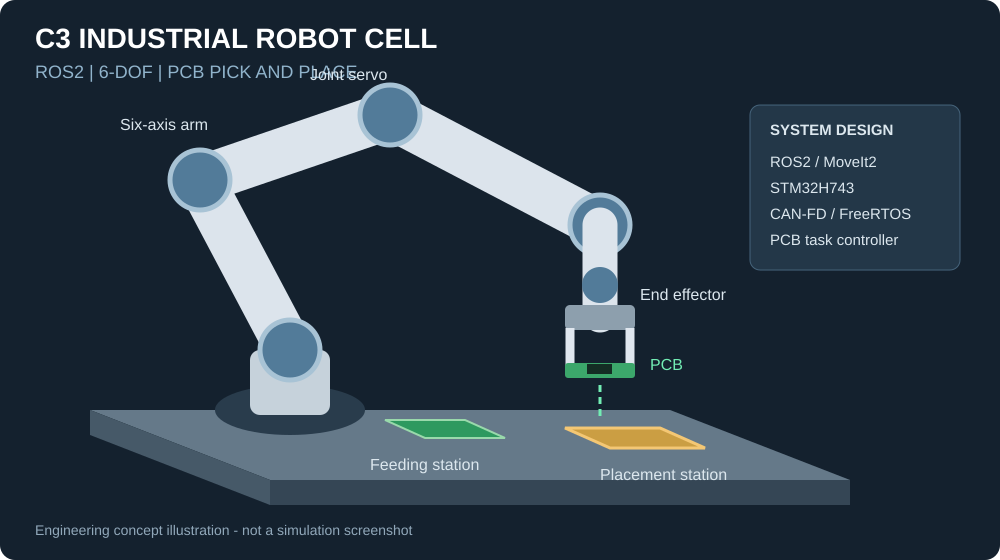
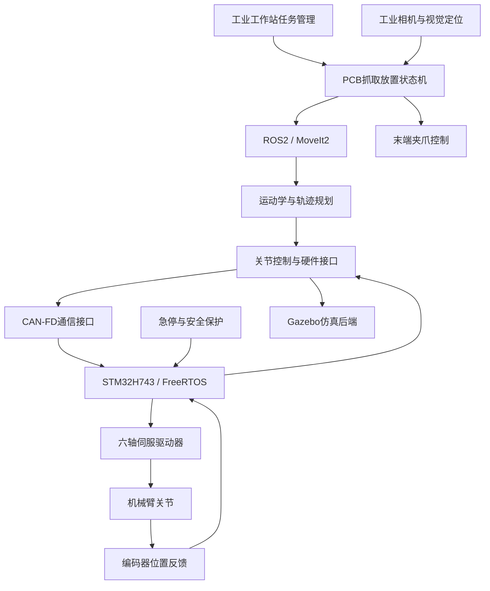
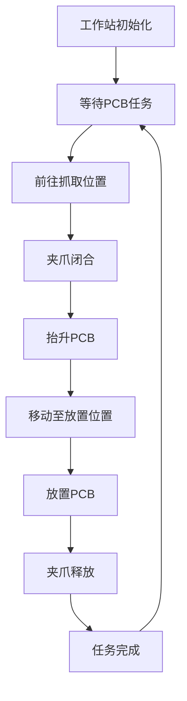
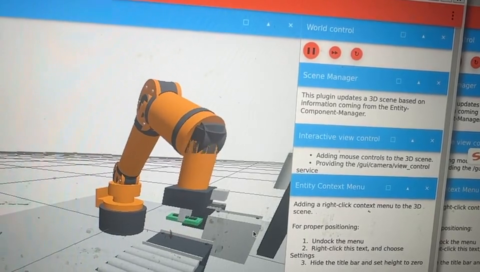

# ROS2 Industrial PCB Robotic Arm


## 1. 项目介绍

本项目面向工业自动化生产线，设计六轴机械臂
PCB 自动抓取、搬运与放置工作站。

项目覆盖机器人建模、运动学、运动规划、
物理仿真、任务调度、底层通信协议、
嵌入式控制器及伺服系统设计。



> 上图为工作站设计示意图，并非实际仿真截图。

## 2. 项目设计指标

| 指标 | 设计目标 |
|---|---|
| 机械臂自由度 | 6 DOF |
| 额定负载 | 0.5 kg |
| 工作半径 | 500 mm |
| 重复定位精度 | ±0.05 mm |
| 控制系统 | ROS 2 + STM32 |
| 伺服通信 | CAN-FD |
| 实时系统 | FreeRTOS |

上述性能指标属于设计目标，尚未经过真实设备测量。

## 3. 系统总体架构



## 4. 硬件清单与设计选型

以下为实机落地参考方案，不代表已经采购或完成实机验证。

| 硬件 | 推荐型号或方案 | 用途 |
|---|---|---|
| 上位机 | Intel工控机 / RK3588 | ROS2、规划、任务管理 |
| 主控芯片 | STM32H743 | 实时运动控制 |
| 实时操作系统 | FreeRTOS | 多任务调度 |
| 关节伺服 | 六轴CAN-FD伺服执行器 | 关节位置与速度控制 |
| 电机选型参考 | CubeMars AK系列 | 按各关节扭矩分别选型 |
| 夹爪舵机 | 飞特 STS3215 | 小型夹爪执行机构参考 |
| CAN收发器 | TCAN1042HGV | CAN-FD物理层 |
| 编码器 | AS5047P | 关节角度检测参考 |
| 电流采样 | INA240 | 电机电流检测参考 |
| 视觉传感器 | 工业RGB相机 | PCB识别与定位 |
| 深度相机 | Intel RealSense D435i | 深度感知参考 |
| 电源 | 24V或48V工业电源 | 按伺服额定参数选择 |
| 降压电源 | DC-DC电源模块 | 逻辑控制电路供电 |
| 安全设备 | 急停按钮、限位开关 | 安全保护 |
| 机械结构 | 铝合金、减速器、轴承 | 六轴机械臂本体 |

具体电机型号、减速比和电源功率需结合各轴负载、
重力矩、惯量、速度与热设计计算后确定。
不同型号执行器的通信协议需要适配，
不能默认直接兼容本项目CAN-FD协议。

## 5. 底层嵌入式控制设计

### STM32H743选型

- Cortex-M7处理器
- 支持FDCAN外设
- 支持定时器、PWM、SPI、UART、DMA
- 适合实时通信、传感器采集与运动控制
- 采用FreeRTOS进行任务管理

### 底层驱动模块

- FDCAN通信驱动
- UART串口通信
- SPI编码器读取
- PWM执行器控制
- 电机状态采集
- CRC数据校验
- 通信超时检测
- 关节软限位
- 故障码与异常上报

### FreeRTOS任务规划

| 任务 | 设计周期 |
|---|---|
| 电机状态采集 | 1 ms |
| 关节控制 | 1 ms |
| CAN-FD通信 | 2 ms |
| 安全状态检测 | 5 ms |
| 状态数据上报 | 10 ms |
| 系统诊断 | 100 ms |

以上为参考调度目标，实时性需通过实机测量验证。

## 6. 上层ROS2软件架构

- URDF/Xacro机器人模型
- 六轴机器人正逆运动学
- TF坐标变换
- MoveIt2运动规划
- 关节轨迹控制
- Gazebo物理仿真
- PCB抓取与放置任务
- ROS2 Service任务控制
- 状态机与错误处理
- 容器化开发与运行

## 7. PCB工作站业务流程



## 8. 开发环境

- Windows + WSL2
- Ubuntu 22.04
- ROS2 Humble
- MoveIt2
- Gazebo Harmonic
- Podman容器
- VS Code Remote WSL
- C / C++ / Python

## 9. 任务控制接口

在工作站已经启动的情况下执行：

```bash
tools/cell ros2 service call /c3/reset std_srvs/srv/Trigger '{}'

tools/cell ros2 service call /c3/step std_srvs/srv/Trigger '{}'

tools/cell ros2 service call /c3/resume std_srvs/srv/Trigger '{}'
```

## 10. 仿真验证记录

| 测试项目 | 验证结果 |
|---|---|
| PCB抓取仿真展示 | PASS |
| PCB放置仿真展示 | PASS |
| reset服务请求 | PASS |
| step服务请求 | PASS |
| resume服务请求 | PASS |
| STM32真实硬件测试 | 待验证 |
| CAN-FD实机联调 | 待验证 |
| 重复定位精度测量 | 待验证 |
| 工业安全认证 | 未进行 |

仿真验证日期：2026-11-25。

## 11. 项目定位

面向工业机器人、嵌入式软件与机器人应用开发的
软硬件一体化工程实践项目。

本项目包含仿真验证和实机参考设计，
不宣称已达到工业量产或安全认证要求。

## 12. 实际仿真运行效果 | Simulation Demo

### 六轴机械臂 PCB 自动抓取与放置



### 完整运行演示视频

[](docs/videos/pcb_demo.mp4)

[点击观看完整演示视频](docs/videos/pcb_demo.mp4)

### 仿真验证内容

- PCB 自动抓取与搬运
- PCB 自动放置
- 六轴机械臂运动控制
- ROS2 Service 任务重置
- ROS2 Service 单步执行
- ROS2 Service 任务恢复

以上图片和视频来源于项目仿真运行过程。
真实硬件驱动、实机精度与工业安全性能仍需进一步验证。

