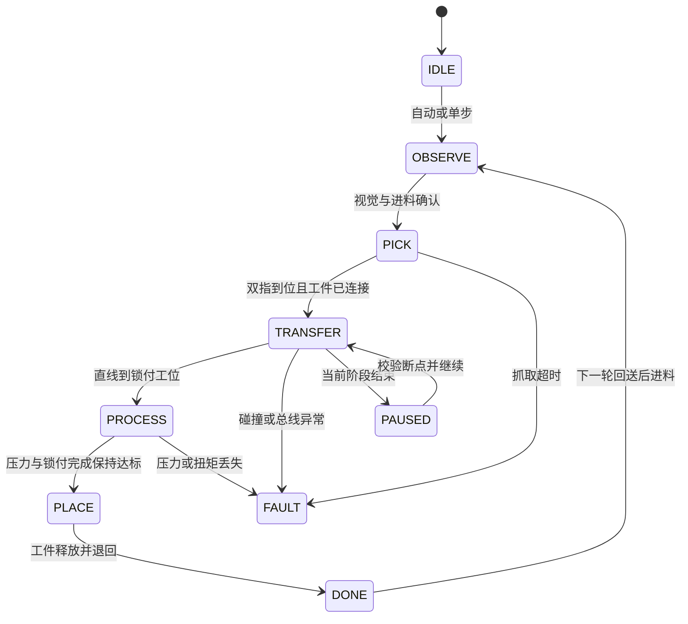

# 任务、故障与恢复

图展示常见转移。代码的工序记录为 observe、prepick、pick、close、lift、transfer、land、screw、up、to_good、lower、open、retreat。任何工序均受急停和锁存故障约束。预抓取使用 MoveIt/OMPL 的关节空间规划；直线和圆弧由 C 逆解生成关节序列，再用 MoveIt 的场景服务沿路径采样验碰。程序还检查奇异值和 IK 分支连续性；受限位或奇异区影响时可切换逆解初值，仍跨不过去会拒绝执行。未实现任意障碍环境中的自动笛卡尔绕行。

|数值|名称|来源与行为|
|---|---|---|
|0x01|急停|硬件辅助输入 / 软件急停，停止输出并锁存|
|0x02|硬限位|EXTI 快速关输出，实时任务记录故障|
|0x04|命令失联|板端超过 100 ms 未见新命令|
|0x08|堵转|位置误差较大、测得低速且高电流持续约 200 个采样周期|
|0x10|供电或过流|母线及轴电流越过示例阈值|
|0x20|意外接触|Gazebo 接触反馈，在下一次处理该接触的物理步清零速度并锁存；碰撞对见 /c3/contact_pair|
|0x40|数值 / 行程越界|位置或采样非法，软限位保护|
|0x80|轴离线 / 总线故障|反馈位不齐、工具离线或必要发送失败|

位可以组合。上层另记录视觉超时、MoveIt 错误、跟踪超时、压力窗口丢失等文字原因。意外接触和抓取期双指碰 PCB、工件就位时触碰夹具分别处理。腕部共轴壳体在模型中配置碰撞例外。求解器采样频率、ROS 调度和硬件制动都会影响实际停止距离。

**断点规则**：每个工序开始前写 pending=true，成功后原子替换为下一工序记录；保存在容器 HOME 的 ~/.ros/c3_arm/checkpoint.json。/pause 在本工序完成后暂停；/step 执行一个工序；/resume 比对反馈关节和实际是否持料。断电打断锁付中段时应现场核验已锁螺丝，系统拒绝自动重复锁付。实机重启还需确认下位机和 MoveIt 已恢复相同作业现场。

**恢复**：规划失败且未持料，可以在检查现场后用 /c3/reset 清上层状态。仿真设备级锁存可通过重启 Gazebo 重建现场，确认回到初始上料状态后手动 /c3/reset。实机由独立安全回路和板级流程复位。重新连接通信不会清除安全锁存。
